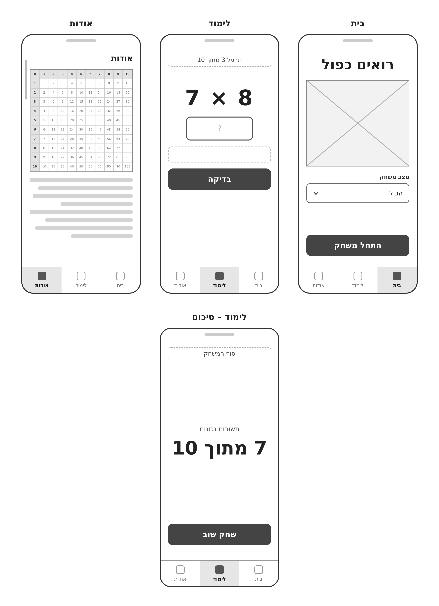
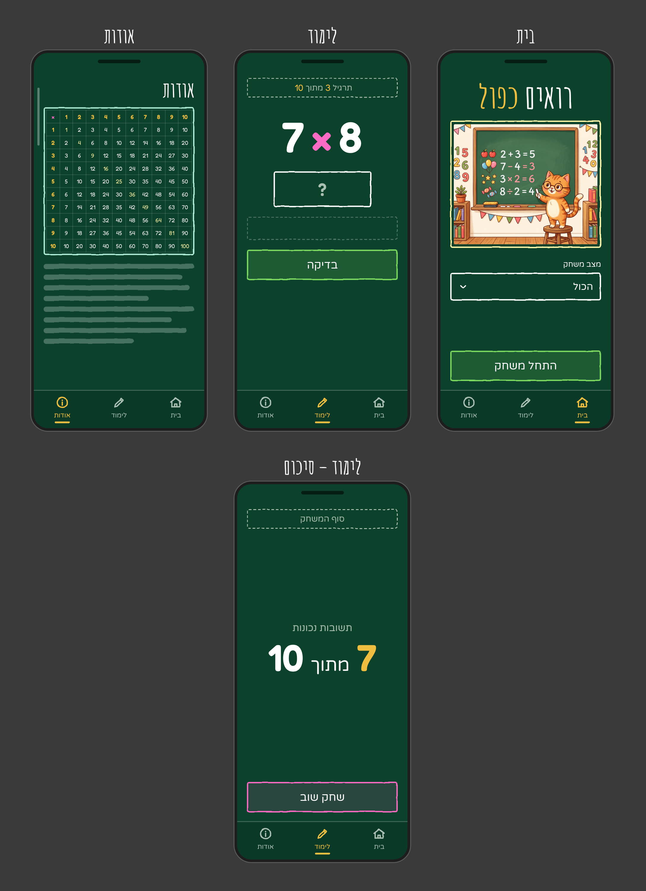
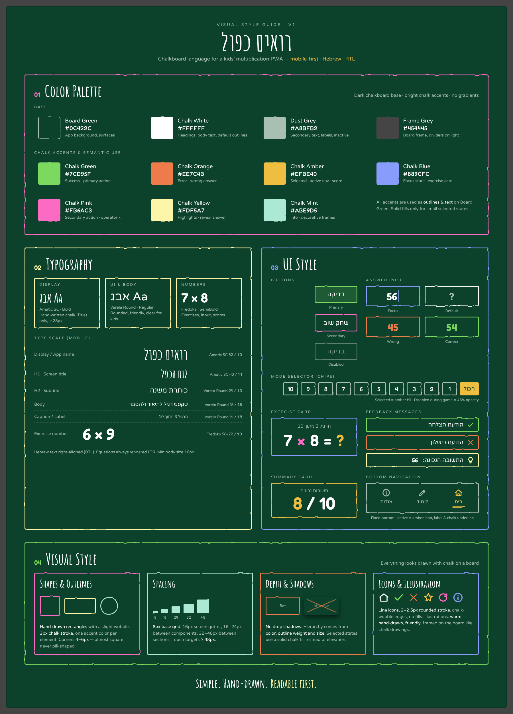

# DESIGN – רואים כפול

מסמך זה מתאר את המימוש העיצובי של האפליקציה. הוא מבוסס על PRD.md, ה-Wireframes, ה-Style Guide וה-Mockups. דרישות המוצר והתנהגות המשחק מתועדות ב-PRD, ולא חוזרות כאן.

**סדר העדיפויות בין המקורות:** מבנה ותוכן לפי ה-Wireframes וה-PRD, שפה חזותית לפי ה-Style Guide, ומראה סופי לפי ה-Mockups.

---

## 1. Screens – מסכי האפליקציה





### מבנה משותף לכל המסכים

- **רקע:** Board Green (`#0C422C`) בכל המסכים.
- **אזור תוכן:** עמודה אחת, ברוחב מלא, עם שוליים צדדיים.
- **סרגל ניווט תחתון (Bottom Navigation):** קבוע בתחתית כל המסכים, בגובה של כ-86px. מעליו קו הפרדה דק ב-Dust Grey שקוף למחצה. הרקע שלו כהה מעט מהרקע הכללי (`#0A3A27` ב-Mockups).
  - שלושה פריטים, מימין לשמאל: **"בית"**, **"לימוד"**, **"אודות"**.
  - כל פריט כולל אייקון קווי (בית, עיפרון, עיגול עם i) ותווית טקסט מתחתיו.
  - **פריט פעיל:** אייקון ותווית ב-Chalk Amber (`#EFBE40`), עם קו תחתון קצר בסגנון גיר באותו צבע.
  - **פריט לא פעיל:** אייקון ותווית ב-Dust Grey (`#A8BFB2`).

---

### 1.1 בית

**מטרת המסך:** נקודת הפתיחה של האפליקציה. כאן הילד בוחר מצב משחק ומתחיל משחק.

**מבנה ותוכן (מלמעלה למטה):**
1. **שם האפליקציה "רואים כפול":** במרכז, בגופן Display (Amatic SC Bold), בגודל גדול (כ-72px ב-Mockups). המילה "רואים" ב-Chalk White, והמילה "כפול" ב-Chalk Amber.
2. **תמונה:** איור בנושא מתמטיקה ברוחב מלא, בתוך מסגרת מצוירת ביד ב-Chalk Yellow (`#FDF5A7`). התמונה ממלאת את המסגרת (Cover). ב-Mockups משמש איור החתול ליד לוח הגיר.
3. **תווית "מצב משחק":** טקסט קטן ב-Chalk White, מיושר לימין, מעל התפריט.
4. **תפריט נפתח (Dropdown):** ברוחב מלא, עם קו מתאר Chalk White מצויר ביד. הערך הנבחר ("הכול" כברירת מחדל) מופיע מימין, וחץ למטה (Chevron) משמאל.
5. **שטח ריק:** מפריד בין התפריט ללחצן.
6. **לחצן "התחל משחק":** Primary, ברוחב מלא, בתחתית אזור התוכן, מעל סרגל הניווט.

**פעולות וניווט:**
- בחירת ערך בתפריט: "הכול", או מספר מ-1 עד 10.
- לחיצה על "התחל משחק" פותחת את מסך **לימוד**.
- **בזמן משחק פעיל** (לפי PRD F1): התפריט והלחצן נשארים פעילים ובאותו עיצוב. רק הכיתוב של הלחצן משתנה: **"המשך משחק"** כשבתפריט מוצג המצב של המשחק הפעיל, ו**"התחל משחק"** כשנבחר מצב אחר. מצב זה אינו מופיע ב-Mockups.
- **מצב פתוח של התפריט:** התפריט הוא התפריט הרגיל של הדפדפן (`<select>`). כשהוא נפתח, הטלפון מציג את הבוחר המובנה שלו, ולכן אין צורך לעצב מצב פתוח. רק המצב הסגור מעוצב לפי מסמך זה.

---

### 1.2 לימוד

**מטרת המסך:** פתרון תרגילי המשחק, אחד אחרי השני.

**מבנה ותוכן (מלמעלה למטה):**
1. **מונה התקדמות "תרגיל 3 מתוך 10":** ברוחב מלא, בתוך מסגרת מקווקוות ב-Dust Grey. הטקסט ב-Dust Grey, והמספרים ב-Chalk Amber בגופן Numbers.
2. **התרגיל (לדוגמה "7 × 8"):** במרכז, בגופן Numbers (Fredoka SemiBold), בגודל גדול מאוד (כ-96px ב-Mockups). המספרים ב-Chalk White, וסימן הכפל × ב-Chalk Pink (`#FB6AC3`). התרגיל מוצג תמיד בכיוון LTR.
3. **תיבת תשובה:** במרכז, ברוחב בינוני (כ-220px) ובגובה של כ-80px, עם קו מתאר Chalk White. כשהיא ריקה מוצג בה סימן "?" ב-Dust Grey. הספרות בגופן Numbers.
4. **אזור משוב:** ברוחב מלא, בגובה קבוע (כ-52px), במסגרת מקווקוות עדינה. כשאין משוב, האזור ריק. כך הלחצן לא זז כשמופיעה הודעה.
5. **לחצן "בדיקה":** Primary, ברוחב מלא.
6. **שטח ריק** עד סרגל הניווט.

**מצבי משוב (מה-Style Guide; מוצגים בתוך אזור המשוב):**
| מצב | קו מתאר וצבע | אייקון |
|---|---|---|
| הצלחה | Chalk Green `#7CD95F` | V |
| כישלון | Chalk Orange `#EE7C4B` | X |
| חשיפת התשובה הנכונה (אחרי 3 ניסיונות) | Chalk Yellow `#FDF5A7` | נורה, והתשובה בגופן Numbers |

**מצבי תיבת התשובה (מה-Style Guide):**
| מצב | קו מתאר | צבע הספרות |
|---|---|---|
| Default | Chalk White | Dust Grey ("?") |
| Focus | Chalk Blue `#889CFC` | Chalk White |
| Correct | Chalk Green | Chalk Green |
| Wrong | Chalk Orange | Chalk Orange |

> נוסח הודעות המשוב מוגדר ב-PRD, סעיף F2. ב-Style Guide מופיעים מצייני מקום בלבד ("הודעת הצלחה", "הודעת כישלון").

**פעולות וניווט:**
- הקלדת תשובה ולחיצה על "בדיקה".
- בסיום התרגיל העשירי, המסך מתחלף למסך **לימוד – סיכום**.
- מעבר למסך אחר דרך סרגל הניווט.

---

### 1.3 אודות

**מטרת המסך:** הצגת לוח הכפל המלא והסבר על האפליקציה.

**מבנה ותוכן (מלמעלה למטה):**
1. **כותרת "אודות":** H1 בגופן Display, מיושרת לימין.
2. **לוח הכפל 10×10:** טבלה של 11×11 תאים, כולל שורת כותרת ועמודת כותרת, ברוחב מלא.
   - הטבלה בתוך מסגרת מצוירת ביד ב-Chalk Mint (`#ABE9D5`), עם קווי רשת דקים ב-Dust Grey שקוף.
   - הטבלה מוצגת בכיוון LTR.
   - שורת הכותרת ועמודת הכותרת (1–10) ב-Chalk Amber, ותא הפינה (×) ב-Chalk Pink.
   - ערכי המכפלות ב-Chalk White, והאלכסון (1, 4, 9 … 100) ב-Chalk Yellow.
   - כל המספרים בגופן Numbers, בגודל קטן (כ-13px).
3. **טקסט הסבר:** מיושר לימין, בגופן Body. ב-Wireframes וב-Mockups הוא מוצג כפסים אפורים (מצייני מקום). זה נוסח הטקסט:

   > **איך משחקים ב"רואים כפול"?**
   >
   > 1. **בוחרים מצב משחק** במסך הבית:
   >    - **"הכול"**: תרגילים מכל לוח הכפל.
   >    - **מספר מ-1 עד 10**: תרגילים רק עם המספר שבחרתם.
   > 2. **לוחצים על "התחל משחק".**
   > 3. **בכל משחק יש 10 תרגילים.** מקלידים את התשובה ולוחצים על "בדיקה".
   > 4. **טעיתם? לא נורא!** יש לכם עוד ניסיון. בכל תרגיל אפשר לנסות עד 3 פעמים. אם לא הצלחתם, נראה לכם את התשובה הנכונה ונמשיך לתרגיל הבא.
   > 5. **נקודה מקבלים רק על תשובה נכונה בניסיון הראשון.**
   > 6. **בסוף המשחק** תראו כמה תשובות נכונות היו לכם מתוך 10. רוצים לנסות שוב? לחצו על "שחק שוב".

   - **עיצוב הטקסט:**
     - הכותרת "איך משחקים ב'רואים כפול'?" ברמת H2.
     - השלבים מוצגים כרשימה ממוספרת, וההדגשות בטקסט נשמרות.
     - לא נקבע צבע נפרד להדגשות. ברירת המחדל היא Chalk White, בהתאם ל-Style Guide.
4. **פס גלילה:** מופיע בצד המסך, כי התוכן עשוי לחרוג מגובה המסך.

**פעולות וניווט:** גלילה בתוכן. מעבר למסכים אחרים דרך סרגל הניווט בלבד.

> ב-PRD נכתב "תמונה של לוח הכפל". ב-Mockups הלוח מעוצב כטבלה בסגנון גיר. **ההחלטה: הלוח ממומש כטבלת HTML** בעיצוב שמתואר כאן, ולא כקובץ תמונה (ראו ARCHITECTURE.md, סעיף 2.12).

---

### 1.4 לימוד – סיכום

**מטרת המסך:** הצגת התוצאה בסוף המשחק ואפשרות לשחק שוב. זה מצב של מסך הלימוד, ולכן בסרגל הניווט מסומן "לימוד".

**מבנה ותוכן (מלמעלה למטה):**
1. **כותרת "סוף המשחק":** ברוחב מלא, בתוך מסגרת מקווקוות ב-Dust Grey, באותו מיקום ובאותו סגנון של מונה ההתקדמות במסך הלימוד.
2. **אזור התוצאה:** במרכז האנכי של המסך.
   - התווית **"תשובות נכונות"** ב-Dust Grey, בגופן UI.
   - מתחתיה התוצאה **"7 מתוך 10"**: מספר התשובות הנכונות ב-Chalk Amber, המילה "מתוך" ב-Chalk White בגופן UI, והמספר 10 ב-Chalk White. המספרים בגופן Numbers, בגודל גדול מאוד (כ-84px ב-Mockups).
3. **לחצן "שחק שוב":** Secondary (קו מתאר Chalk Pink), ברוחב מלא, בתחתית אזור התוכן.

**פעולות וניווט:**
- "שחק שוב" מתחיל משחק חדש ומחזיר לתצוגת מסך **לימוד**.
- מעבר למסך **בית** דרך סרגל הניווט, כדי לבחור מצב משחק אחר.

---

### 1.5 מבנה הניווט הכללי

```
                 ┌──────── סרגל ניווט תחתון (בכל המסכים) ────────┐
                 │        בית   ◄──►   לימוד   ◄──►   אודות          │
                 └────────────────────────────────────────────────┘

  בית ──("התחל משחק")──► לימוד ──(תרגיל 10 הסתיים)──► לימוד – סיכום
                           ▲                               │
                           └─────────("שחק שוב")───────────┘
```

- הניווט בין שלושת המסכים הראשיים נעשה רק דרך סרגל הניווט התחתון.
- "לימוד" ו"לימוד – סיכום" הם שני מצבים של אותה לשונית.

---

## 2. Style Guide – השפה העיצובית



**האווירה:** לוח גיר ירוק כהה, שעליו כל הרכיבים נראים כאילו צוירו ביד בגיר צבעוני. הממשק פשוט, ידידותי לילדים, וקריאות קודמת לקישוט.

### 2.1 Color Palette

**צבעי בסיס**

| שם | HEX | שימוש |
|---|---|---|
| Board Green | `#0C422C` | רקע האפליקציה ומשטחים |
| Chalk White | `#FFFFFF` | כותרות, טקסט, קווי מתאר ברירת מחדל |
| Dust Grey | `#A8BFB2` | טקסט משני, תוויות, פריטים לא פעילים |
| Frame Grey | `#454445` | מסגרת הלוח, קווי הפרדה על רקע בהיר |

**צבעי גיר ושימושים סמנטיים**

| שם | HEX | שימוש |
|---|---|---|
| Chalk Green | `#7CD95F` | הצלחה, פעולה ראשית (Primary) |
| Chalk Orange | `#EE7C4B` | שגיאה, תשובה שגויה |
| Chalk Amber | `#EFBE40` | פריט נבחר, ניווט פעיל, ניקוד ומספרים מודגשים |
| Chalk Blue | `#889CFC` | מצב Focus |
| Chalk Pink | `#FB6AC3` | פעולה משנית (Secondary), סימן × |
| Chalk Yellow | `#FDF5A7` | הדגשות, חשיפת התשובה, מסגרת התמונה |
| Chalk Mint | `#ABE9D5` | מידע, מסגרות דקורטיביות (לוח הכפל) |

**כללי שימוש:**
- צבעי הגיר משמשים בעיקר לקווי מתאר ולטקסט על רקע Board Green.
- מילוי מלא בצבע רק במצבים נבחרים קטנים. בלחצנים יש מילוי שקוף ועדין בצבע הקו.
- ללא Gradients.

### 2.2 Typography

**משפחות גופנים** (שלושתן תומכות בעברית):

| תפקיד | גופן | שימוש |
|---|---|---|
| Display | Amatic SC Bold | שם האפליקציה וכותרות מסכים בלבד. כתב יד בסגנון גיר. לא פחות מ-28px. |
| UI & Body | Varela Round Regular | תוויות, לחצנים, טקסט רגיל. מעוגל וקריא לילדים. |
| Numbers | Fredoka SemiBold | תרגילים, תיבת התשובה, מונים וניקוד. |

**היררכיית טקסט (מובייל)**

| רמה | גופן | גודל / גובה שורה | דוגמה |
|---|---|---|---|
| Display / שם האפליקציה | Amatic SC | 52px / 1.0 (ב-Mockups: כ-72px במסך הבית) | רואים כפול |
| H1 – כותרת מסך | Amatic SC | 40px / 1.1 | אודות |
| H2 – כותרת משנה | Varela Round | 24px / 1.3 | — |
| Body | Varela Round | 18px / 1.5 | טקסט ההסבר |
| Caption / Label | Varela Round | 14px / 1.4 | תרגיל 3 מתוך 10 |
| מספר תרגיל | Fredoka | 56–72px / 1.0 (ב-Mockups: כ-96px) | 7 × 8 |

- גודל מינימלי לטקסט רגיל: 16px.
- **ההבדל בין ה-Style Guide ל-Mockups:** ב-Mockups, שם האפליקציה והתרגיל גדולים מהמוגדר בסולם. זה מתאים למסך שבו הם התוכן המרכזי.

### 2.3 UI Style

**לחצנים**
- צורה: מלבן ברוחב מלא, בגובה של כ-60–68px, עם קו מתאר מצויר ביד בעובי 3px.
- **Primary** (לדוגמה "התחל משחק", "בדיקה"): קו מתאר Chalk Green, מילוי Chalk Green שקוף (כ-16%) וטקסט Chalk White.
- **Secondary** (לדוגמה "שחק שוב"): קו מתאר Chalk Pink, מילוי Chalk Pink שקוף מאוד וטקסט Chalk White.
- **Disabled:** קו מתאר וטקסט בגוון ירוק-אפרפר עמום.
- הטקסט בגופן UI, כ-22–25px.

**שדה קלט (תיבת התשובה)**
- מלבן עם קו מתאר מצויר ביד. הספרות בגופן Numbers, ממורכזות, בכיוון LTR.
- מצבים: ראו טבלת המצבים בסעיף 1.2.

**תפריט נפתח (Dropdown)**
- מלבן ברוחב מלא, עם קו מתאר Chalk White. הערך מימין, והחץ משמאל.

**כרטיסים ומסגרות**
- **מסגרת מקווקוות** (Dust Grey): למונה ההתקדמות, לכותרת "סוף המשחק" ולאזור המשוב.
- **מסגרת רציפה בצבע גיר:** לתוכן מרכזי, כמו התמונה (Chalk Yellow) ולוח הכפל (Chalk Mint).

**הודעות משוב**
- מלבן ברוחב מלא, עם קו מתאר בצבע הסמנטי. האייקון מימין, והטקסט לידו ב-RTL. ראו טבלה בסעיף 1.2.

**סרגל ניווט**
- ראו "מבנה משותף לכל המסכים" בסעיף 1.

**אייקונים**
- אייקונים קוויים בעובי 2–2.5px, עם קצוות מעוגלים וקווים מעט "רועדים" בסגנון גיר. ללא מילוי.
- אייקונים בשימוש: בית, עיפרון (לימוד), i בעיגול (אודות), V, X, נורה, חץ למטה.

> רכיב ה-Chips (בורר מצב) מה-Style Guide כבר לא בשימוש. בחירת המצב עברה לתפריט נפתח במסך הבית, בהתאם ל-Wireframes ול-PRD.

### 2.4 Visual Style

- **צורות וקווי מתאר:** מלבנים עם קו מתאר מצויר ביד, עם "רעד" קל. עובי הקו 3px, וכל רכיב בצבע גיר אחד.
- **פינות:** 4–6px, כמעט ישרות. לא בצורת גלולה (Pill).
- **צללים:** ללא צללים. ההיררכיה נוצרת מצבע, מעובי הקו ומגודל. מצבים נבחרים מקבלים מילוי צבע, לא הגבהה.
- **מרווחים (Spacing):** רשת בסיס של 8px.
  - שוליים צדדיים במסך: לפחות 16px (ב-Mockups: כ-22px).
  - בין רכיבים: 16–24px.
  - בין קבוצות תוכן: 32–48px.
- **אזורי מגע:** לפחות 48px.
- **פריסה (Layout):** עמודה אחת, ממורכזת. רכיבי הפעולה הראשית ברוחב מלא, בתחתית אזור התוכן, מעל סרגל הניווט. התוכן המרכזי, כמו תרגיל או תוצאה, ממורכז ובולט.
- **תמונות ואיורים:** איורים חמים, מצוירים ביד וידידותיים, ממוסגרים על הלוח כמו ציורי גיר. דוגמה: איור החתול במסך הבית.
- **אווירה כללית:** "פשוט. מצויר ביד. קריאות קודם."

### 2.5 שפה וכיווניות

- **שפת הממשק:** עברית בלבד.
- **כיווניות:** RTL בכל הממשק. טקסט מיושר לימין, וסדר הרכיבים בשורה מימין לשמאל, כולל סרגל הניווט ("בית" בצד ימין).
- **חריגים בכיוון LTR:**
  - התרגיל (לדוגמה "7 × 8").
  - הספרות בתיבת התשובה.
  - טבלת לוח הכפל.
- **טקסט ממורכז:** שם האפליקציה, התרגיל, המונה, התוצאה ותוויות הלחצנים.
